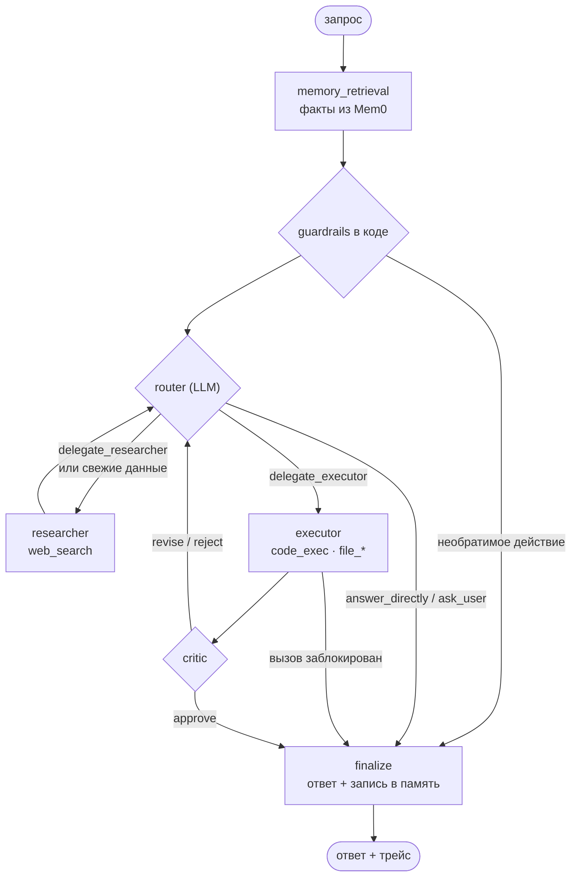

# llm-agent

[](https://github.com/lalefrutto/llm-agent/actions/workflows/tests.yml)

Мультиагентный ассистент на **локальной open-source LLM**: отвечает с учётом памяти о пользователе, ищет свежую информацию в интернете, выполняет код в изолированной песочнице и показывает пошаговый трейс того, как пришёл к ответу. Всё работает на одной машине с GPU на 8 GB — без внешних LLM-API.

## Возможности

- **Мультиагентный граф на LangGraph.** Роутер решает, ответить самому или делегировать: `researcher` (веб-поиск), `executor` (код и файлы в песочнице), `critic` (проверка результата). Результаты вычислений проходят через критика и детерминированную проверку «каждое число в ответе есть в stdout кода».
- **Guardrails в коде, а не только в промпте.**
  - Необратимые действия (удаление файлов, отправка писем, платежи) останавливаются до LLM и выполняются только после явного «да, подтверждаю».
  - Вопросы о свежих данных (новости, «за последнюю неделю», курсы, последние версии) всегда идут в веб-поиск; если поиск ничего не нашёл, агент так и говорит, а не пересказывает устаревшие знания модели.
  - Код с сетью, разрушающие операции и выход за рабочую папку блокируются; блокировка сразу завершает запрос.
- **Изолированное выполнение кода.** Каждый вызов — новый контейнер `--network none --read-only`, 512 MB, 1 CPU, таймаут 30 с.
- **Долгосрочная память (Mem0 + Qdrant).** Сохраняются только утверждения пользователя о себе — вопросы и поручения до экстрактора не доходят, поэтому модель не запоминает собственные ответы как «факты». Поиск — на мультиязычных эмбеддингах `bge-m3` с порогом релевантности: в контекст попадают только факты по теме вопроса. На вопросы о себе без данных в памяти агент отвечает «не знаю», а не угадывает.
- **Skills.** Процедуры из `skills/*/SKILL.md` подгружаются в промпт нужного под-агента по триггерам запроса.
- **Веб-чат.**
  - Ответ печатается по мере генерации, шаги агента появляются по ходу работы.
  - Треды как в обычном чат-боте: список, автоназвание от модели, переименование, удаление (с выбором — забыть ли факты из треда).
  - Под каждым ответом раскрывается трейс: какие факты достала память (со score), что и почему решил роутер, какой код выполнялся и что он вывел, вердикт критика, время каждого шага.
  - Экран «память»: что агент о вас знает, из какого треда пришёл каждый факт, удаление по одному или всех сразу.
- **Наблюдаемость.** Трейсы по узлам графа в Langfuse; метрики в Prometheus с дашбордом в Grafana; алерты в Alertmanager (ошибки, латентность, попытки выхода из песочницы, зацикливание, битый JSON роутера).
- **Evals.** Живой прогон датасета с повторами (`pass@k`, `pass^k`), A/B-замер skills и 90+ детерминированных тестов с подменённой LLM в CI.

## Как устроен запрос



## Стек

| Слой | Что используется |
|---|---|
| LLM | Hermes-3 (Llama 3.1 8B, Q4_K_M) через Ollama, контекст 12k |
| Оркестрация | LangGraph, checkpointer на SQLite |
| Память | Mem0 + Qdrant, мультиязычные эмбеддинги `bge-m3` (на CPU) |
| Песочница | эфемерные Docker-контейнеры без сети |
| API и UI | FastAPI + одностраничный веб-чат без сборки |
| Наблюдаемость | Langfuse, Prometheus, Grafana, Alertmanager |

## Требования

NVIDIA GPU с 8 GB+ VRAM, Docker Desktop, Ollama, Python 3.11 (для тестов и evals). Проверено на Windows 11 с RTX 4060.

## Первый запуск

1. Модели. `atlas-hermes3-12k` — тот же Hermes-3, но с контекстом 12k вместо стандартных 4k (без этого Ollama обрезает системный промпт). `atlas-bge-m3-cpu` — эмбеддер на процессоре, чтобы не отнимать видеопамять у основной модели:

    ```bash
    ollama pull hermes3:8b-llama3.1-q4_K_M
    ollama pull bge-m3
    ollama create atlas-hermes3-12k -f config/ollama/hermes3-12k.Modelfile
    ollama create atlas-bge-m3-cpu -f config/ollama/bge-m3-cpu.Modelfile
    ```

2. Образ песочницы и весь стек:

    ```bash
    docker build -t agent-exec-sandbox:latest -f docker/Dockerfile.sandbox .
    docker compose -f docker/docker-compose.yml up -d --build
    ```

3. Через 3–5 минут, когда у `agent-app` появится статус `healthy` (`docker compose -f docker/docker-compose.yml ps`), откройте **http://localhost:8080**. Первый ответ занимает около минуты — модель загружается в видеокарту.

## Повторный запуск (например, после перезагрузки)

Запустите Ollama и Docker Desktop, затем:

```bash
docker compose -f docker/docker-compose.yml up -d
```

Треды, история и память хранятся в томах Docker и переживают перезапуск. Остановить стенд — `docker compose -f docker/docker-compose.yml down` (без `-v`, иначе удалятся данные).

## Адреса

| Сервис | Адрес | Доступ |
|---|---|---|
| Веб-чат и API | http://localhost:8080 | — |
| Langfuse (трейсы) | http://localhost:3000 | atlas@example.com / atlas-password |
| Grafana (дашборд «Atlas Agent») | http://localhost:3001 | admin / admin |
| Prometheus | http://localhost:9090 | — |
| Qdrant | http://localhost:6333 | — |

## API

| Метод | Путь | Что делает |
|---|---|---|
| `POST` | `/chat` | `{user_id, thread_id?, message}` → ответ, маршрут, трейс, название треда |
| `POST` | `/chat/stream` | то же потоком NDJSON: `start`, `step` (шаг трейса), `token` (кусок ответа), `done` / `error` |
| `GET` | `/threads?user_id=…` | список тредов пользователя |
| `GET` | `/threads/{id}` | история треда |
| `PATCH` | `/threads/{id}` | переименовать `{user_id, title}` |
| `DELETE` | `/threads/{id}?user_id=…&forget_memory=0\|1` | удалить тред (по желанию — и факты из него) |
| `GET` | `/memory?user_id=…` | что агент знает о пользователе |
| `DELETE` | `/memory/{id}?user_id=…`, `/memory?user_id=…` | забыть один факт / всё |
| `GET` | `/metrics`, `/health` | метрики Prometheus, healthcheck |

```bash
curl -X POST http://localhost:8080/chat -H "Content-Type: application/json" -d '{"user_id":"u1","message":"Посчитай 18% от 4500"}'
```

## Тесты и evals

```bash
python -m venv .venv && .venv/Scripts/activate      # Linux: source .venv/bin/activate
pip install -r requirements.txt

pytest tests/ -q                                     # без Ollama и Docker
python evals/run_evals.py --dataset evals/dataset.jsonl --live --repeats 5
python evals/run_evals.py --dataset evals/dataset.jsonl --live --only t13,t14 --repeats 3
python evals/ab_skills.py --repeats 3                # A/B: со skills и без
python evals/compare_models.py                       # сравнение моделей-кандидатов
```

Смена модели эмбеддингов: `python memory/migrate_embeddings.py --users <user_id>` переносит факты в новую коллекцию с пересчётом векторов.

Для живых evals нужны запущенный стек и переменные `MEMORY_BACKEND=mem0`, `SANDBOX_WORKSPACE_VOLUME=docker_agent_workspace`. Результаты прогонов лежат в `evals/results/`.

## Структура

```
agent/          граф (graph.py), guardrails, skills, треды, инструменты, веб-чат
memory/         обёртка над Mem0 и политика памяти
prompts/        системные промпты роутера и под-агентов
identity/       SOUL.md, VALUES.md, CAPABILITIES.md
skills/         SKILL.md для под-агентов
config/         роли моделей и Modelfile с контекстом 12k
docker/         docker-compose и образы агента и песочницы
observability/  Prometheus, алерты, Grafana, OTel
evals/          датасет, прогоны, сравнение моделей, A/B skills
tests/          детерминированные тесты (запускаются в CI)
```

## Переменные окружения

| Переменная | По умолчанию | Назначение |
|---|---|---|
| `OLLAMA_BASE_URL` | `http://localhost:11434/v1` | адрес Ollama |
| `AGENT_DEFAULT_MODEL` | `atlas-hermes3-12k` | модель по умолчанию; роли — `config/models.yaml` |
| `AGENT_MODEL_OVERRIDE` | — | одна модель на все роли |
| `MEMORY_BACKEND` | `auto` | `mem0` / `local` |
| `QDRANT_URL` | `http://localhost:6333` | |
| `MEM0_EMBED_MODEL` / `MEM0_COLLECTION` | `atlas-bge-m3-cpu` / `mem0_bge_m3` | эмбеддер и коллекция Qdrant |
| `MIN_MEMORY_SCORE` | `0.5` | порог релевантности фактов из памяти |
| `SEARCH_PROVIDER` | `ddgs` | `tavily` (+ `TAVILY_API_KEY`) / `none` |
| `SANDBOX_WORKSPACE_VOLUME` | — | named volume для песочницы |
| `CHECKPOINT_DB` / `THREADS_DB` | `./checkpoints.sqlite` / `./threads.sqlite` | история и список тредов |
| `LANGFUSE_HOST` / `LANGFUSE_PUBLIC_KEY` / `LANGFUSE_SECRET_KEY` | — | трейсинг (без ключей выключен) |
